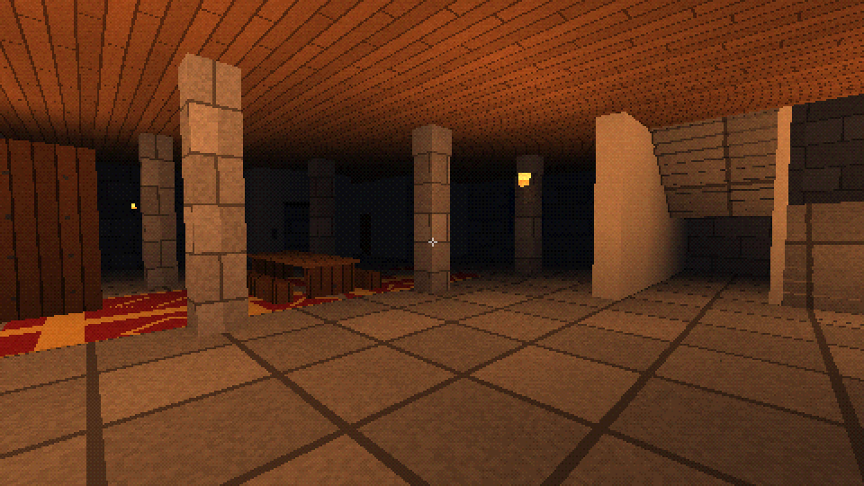
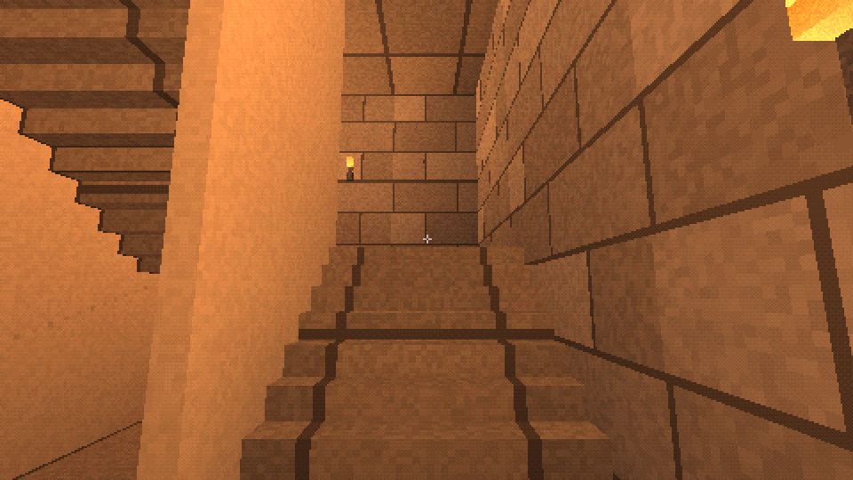
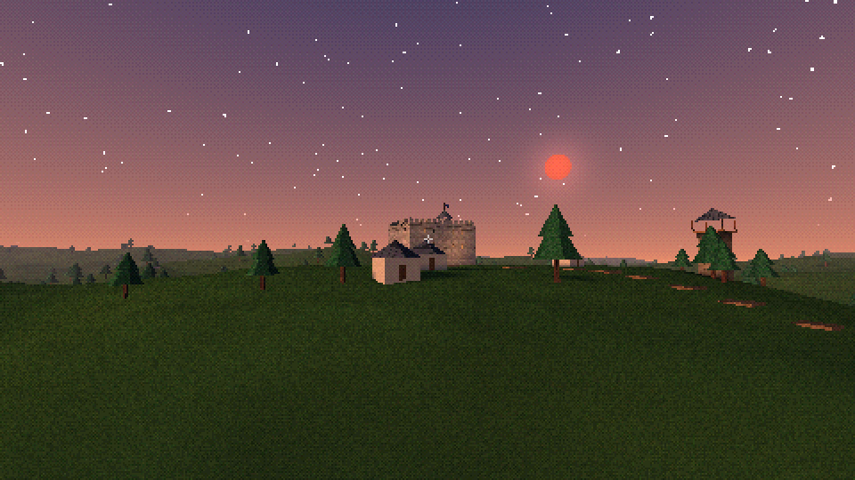
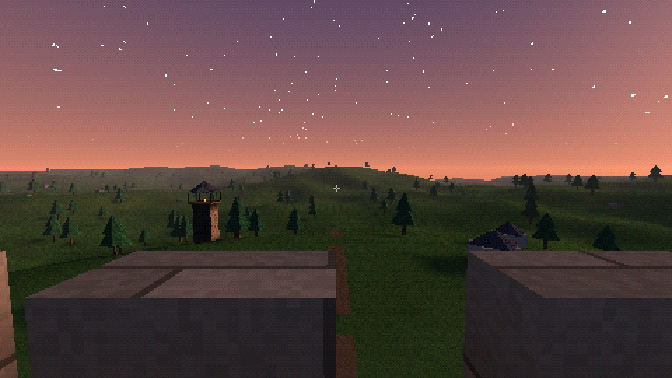

# 1stPRTS

**A first-person fantasy real-time strategy game.** In the tradition of classic fantasy RTS,
serfs haul gold and timber, knights charge, giants hurl boulders, galleons trade broadsides and
drakes burn the sky. You see all of it only through your commander's eyes. Keeps, mines, war
galleons, siege towers, skyships, walking beast-fortresses and floating citadels are built at real
size with real crews, and you can walk inside every one of them. Orders travel by enchanted
sending stones, war horns, banners, messengers and face-to-face conversations. The look is retro
3D: low-poly models, sprites and voxels.

> **Status: M1 (engine foundation) in progress.** The C engine boots, loads all content
> from `data/`, and renders the **Proving Ground** test map in first person on Linux (OpenGL 3.3).
> You can walk around, open doors, climb the stairs and ride the hoist lift to the war room. 24 of
> the 75 M1 tasks are done; web, touch, WebXR, audio and UI come next (see
> [`tasks.md`](openspec/changes/add-engine-foundation/tasks.md)).


| | | |
|---|---|---|
|  |  |  |
|  |  |  |

## Read this first

| | |
|---|---|
| 🎯 **Concept** | [`docs/concept/`](docs/concept/README.md): pitch, pillars, the commander, command and control, scale, units, economy, setting, art, controls, modding, roadmap, open questions |
| 🏗️ **Architecture** | [`docs/architecture/`](docs/architecture/README.md): engine and script split, simulation, rendering, data and Lua API, quality and build |
| 📐 **Specs** | [`openspec/`](openspec/): spec-driven development with [OpenSpec](https://github.com/Fission-AI/OpenSpec). The first change: [`add-engine-foundation`](openspec/changes/add-engine-foundation/proposal.md) |
| ❓ **Open questions** | [`docs/concept/13-open-questions.md`](docs/concept/13-open-questions.md) |

## Key facts

- **Engine**: C11, SDL3, OpenGL 3.3 core / WebGL 2. No game content compiled in (`engine/`, `apps/`).
- **Game**: Lua 5.4 scripts plus assets in `data/`, next to the executable. Fully moddable.
- **Design scope**: four playable factions, 84 unit types and 58 building types (see the concept).
- **Platforms**: Windows, Linux, macOS, web (Emscripten), mobile web with automatic touch
  controls, and WebXR.
- **Quality**: ≥ 95% unit-test coverage (C and Lua), automated headless game tests, determinism
  and replay checks, render golden images, browser end-to-end tests, CI on every platform.
- **First-Person Contract**: gameplay never leaves the commander's eyes. See
  [docs/concept/01](docs/concept/01-vision-and-pillars.md#the-first-person-contract).

## Working with specs

```sh
npm install                 # installs the pinned OpenSpec CLI (dev tool only)
npx openspec list           # changes in progress
npx openspec show add-engine-foundation
npx openspec validate --strict
```

## Building and running

Requirements: CMake ≥ 3.24, Ninja, a C11 compiler (GCC, Clang or MSVC) and Git. SDL 3 is
downloaded and built automatically. On Linux you also need the X11/Wayland, GL and audio
development packages SDL 3 lists (`libx11-dev libxext-dev libxrandr-dev libxcursor-dev libxi-dev
libxss-dev libxfixes-dev libxtst-dev libxkbcommon-dev libegl-dev libgl-dev`).

```sh
cmake --preset dev            # or: release
cmake --build --preset dev
./build/dev/bin/1stprts       # data/ is copied next to the executable
```

Controls: WASD to move, mouse to look, Shift to run, Alt to sprint, Ctrl to crouch, Space to
jump, E to use (doors, lift levers), Esc to quit. `1stprts --help` lists the command-line options.

### Tests

```sh
cmake --preset coverage && cmake --build --preset coverage
xvfb-run -a ctest --preset coverage                          # C, Lua, scenario and rendered tests
gcovr --filter engine/src/ --object-directory build/coverage --fail-under-line 95
python3 -I tools/coverage/lua_gate.py build/coverage/lua-coverage --min 95
python3 -I tools/check_layering.py && python3 -I tools/validate_assets.py
```

Automated game tests are Lua scenarios in [`tests/game/scenarios/`](tests/game/scenarios/).
They run headless (`1stprts --headless --scenario <file>`), or with a window to save
screenshots:

```sh
xvfb-run -a ./build/dev/bin/1stprts --size 1920x1080 --scenario tests/game/scenarios/tour.lua --out shots
```

## License

- **Code** (C, Lua, GLSL, tools): [MIT](LICENSE)
- **Art and content** (models, textures, sprites, voxels, sounds, music, maps…):
  [CC BY 4.0](LICENSE-ASSETS)
- Details, the dividing rule and the attribution format: [LICENSING.md](LICENSING.md)
