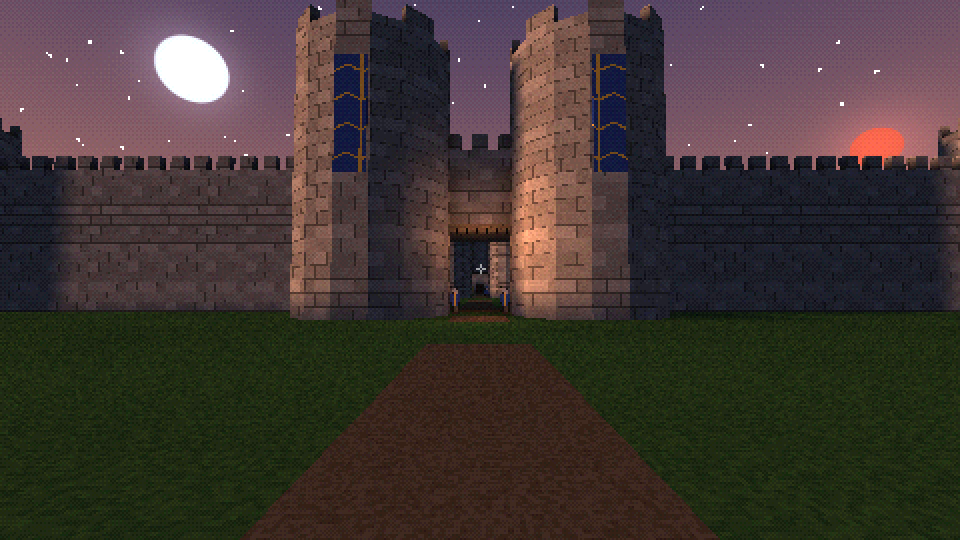
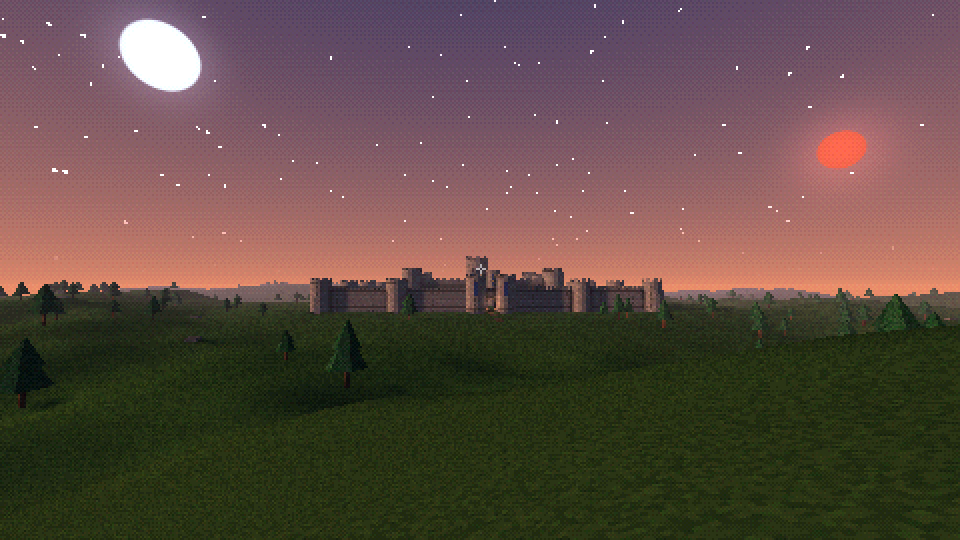
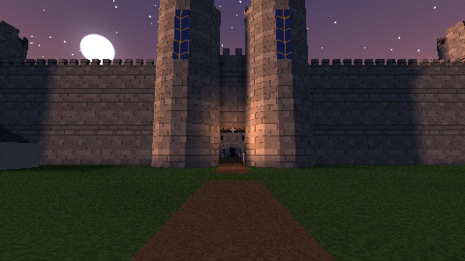
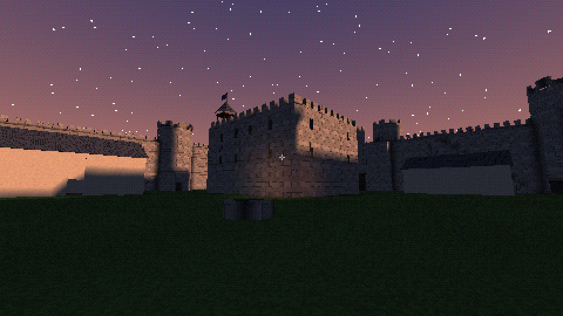
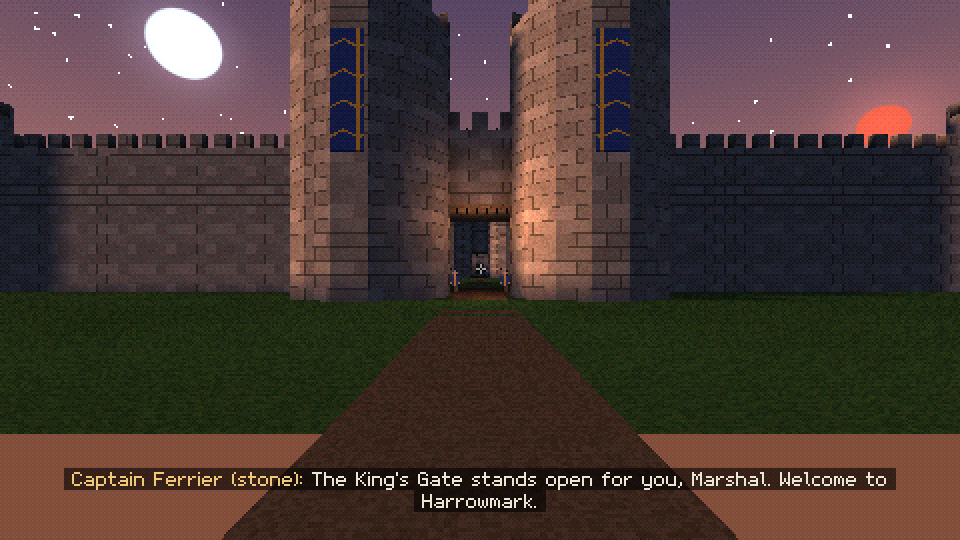
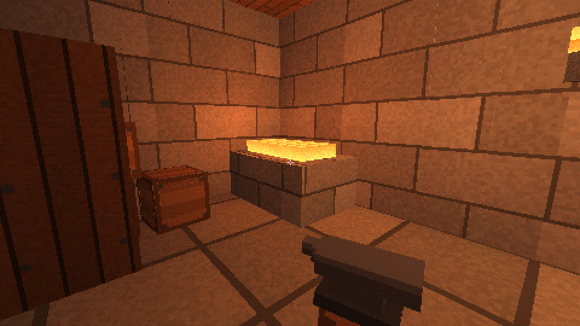

# Banner & Bastion

***War through a commander's eyes.*** Banner & Bastion (codename **1stPRTS**) is a first-person
fantasy real-time strategy game. In the tradition of classic fantasy RTS, serfs haul gold and
timber, knights charge, giants hurl boulders, galleons trade broadsides and drakes burn the sky.
You see all of it only through your commander's eyes, and you lead the way a commander would:
from your fortresses, with banners, war horns, enchanted sending stones, messengers and
face-to-face orders. Keeps, mines, war galleons, siege towers, skyships, walking beast-fortresses
and floating citadels are built at real size with real crews, and you can walk inside every one
of them. The look is retro 3D: low-poly models, sprites and voxels.

> **Status: M1 (engine foundation) nearly done.** The C engine runs on Windows, Linux, macOS
> and in the browser (WebGL 2, touch controls on phones, WebXR). It loads all content from
> `data/` and plays **Harrowmark** (the Proving Ground map), the Crown's border castle, in first
> person. You arrive as its newly sworn Marshal on the road before the King's Gate: walk through
> the gates and wards, up to the wall-walks and the Raven Tower, open doors, climb the keep's
> stairs (including a spiral stair to the roof), ride the hoist lift to the war room with its
> live illusion table, and talk to the castle's people about the silent north
> ([the story](docs/concept/15-story.md)). Along the way: people sprites, glTF and voxel props,
> positional sound with muffling behind closed doors, music, subtitles, a front-end menu,
> options, credits, saves and replays. See [`tasks.md`](openspec/changes/add-engine-foundation/tasks.md) for
> which M1 tasks are done and how each was verified.



| | | |
|---|---|---|
|  |  |  |
|  |  |  |
|  |  |  |
|  |  |  |

## Read this first

| | |
|---|---|
| 🎯 **Concept** | [`docs/concept/`](docs/concept/README.md): pitch, pillars, the commander, command and control, scale, units, economy, setting, art, controls, modding, roadmap, open questions, story |
| 🏗️ **Architecture** | [`docs/architecture/`](docs/architecture/README.md): engine and script split, simulation, rendering, data and Lua API, quality and build |
| 📐 **Specs** | [`openspec/`](openspec/): spec-driven development with [OpenSpec](https://github.com/Fission-AI/OpenSpec). Changes: [`add-engine-foundation`](openspec/changes/add-engine-foundation/proposal.md) (M1) and [`add-harrowmark-and-story`](openspec/changes/add-harrowmark-and-story/proposal.md) (the castle, the story and the title) |
| ❓ **Open questions** | [`docs/concept/13-open-questions.md`](docs/concept/13-open-questions.md) |

## Key facts

- **Engine**: C11, SDL3, OpenGL 3.3 core / WebGL 2. No game content compiled in (`engine/`, `apps/`).
- **Game**: Lua 5.4 scripts plus assets in `data/`, next to the executable. Fully moddable.
- **Design scope**: four playable factions, 84 unit types and 58 building types (see the concept).
- **Platforms**: Windows, Linux, macOS, web (Emscripten), mobile web with automatic touch
  controls, and WebXR.
- **Quality**: ≥ 95% unit-test coverage (C and Lua), automated headless game tests, determinism
  and replay checks, render golden images, browser end-to-end tests, CI on every platform.
- **First-Person Contract**: gameplay never leaves the commander's eyes. See
  [docs/concept/01](docs/concept/01-vision-and-pillars.md#the-first-person-contract).

## Working with specs

```sh
npm install                 # installs the pinned OpenSpec CLI (dev tool only)
npx openspec list           # changes in progress
npx openspec show add-engine-foundation
npx openspec validate --strict
```

## Building and running

Requirements: CMake ≥ 3.24, Ninja, a C11 compiler (GCC, Clang or MSVC) and Git. SDL 3 is
downloaded and built automatically. On Linux you also need the X11/Wayland, GL and audio
development packages SDL 3 lists (`libx11-dev libxext-dev libxrandr-dev libxcursor-dev libxi-dev
libxss-dev libxfixes-dev libxtst-dev libxkbcommon-dev libegl-dev libgl-dev`).

```sh
cmake --preset dev            # or: release
cmake --build --preset dev
./build/dev/bin/1stprts       # data/ is copied next to the executable
```

The game opens with the front-end menu; starting Harrowmark there plays a short prologue (it
can be turned off under Options, Game). `--start proving_ground` goes straight to the map,
without it. Controls: WASD to move, mouse to look, Shift to run, Alt to sprint, Ctrl to crouch,
Space to jump, E to use (doors, lift levers, talking to people), Esc for the menu (options,
credits, quit); a gamepad works
too, and every binding can be changed in Options. In developer builds the backquote key opens
the developer console. `1stprts --help` lists the command-line options.

### Tests

```sh
cmake --preset coverage && cmake --build --preset coverage
xvfb-run -a ctest --preset coverage                          # C, Lua, scenario and rendered tests
gcovr --filter engine/src/ --object-directory build/coverage --fail-under-line 95
python3 -I tools/coverage/lua_gate.py build/coverage/lua-coverage --min 95
python3 -I tools/check_layering.py && python3 -I tools/validate_assets.py
```

Automated game tests are Lua scenarios in [`tests/game/scenarios/`](tests/game/scenarios/).
They run headless (`1stprts --headless --scenario <file>`), or with a window to save
screenshots:

```sh
xvfb-run -a ./build/dev/bin/1stprts --size 1920x1080 --scenario tests/game/scenarios/tour.lua --out shots
```

### Web build (Emscripten) and browser tests

Install the [Emscripten SDK](https://emscripten.org/docs/getting_started/downloads.html)
(CI uses 7.0.0) and activate it, so `EMSDK` is set. The build produces `1stprts.html`, `.js`,
`.wasm` and the game data as a separate `1stprts.data` (+ `1stprts.data.js`) in
`build/web-release/bin/`; serve that folder over HTTP and open `1stprts.html` (it opens the
front-end menu; `1stprts.html?start=proving_ground` goes straight to the map, like `--start`).

```sh
source "$EMSDK/emsdk_env.sh"
cmake --preset web-release -DPRTS_WEB_TEST_HOOKS=ON   # hooks only for tests; web-dev has them on
cmake --build --preset web-release
python3 -m http.server 8000 --directory build/web-release/bin   # http://localhost:8000/1stprts.html
(cd web && npm ci && npx playwright install chromium) && node web/tests/run.js
```

The browser tests (`web/tests/`) cover boot, keyboard input, touch emulation, the missing-WebGL 2
message, settings kept in IndexedDB across reloads and a WebXR session with a mocked headset.
Real phones and headsets are checked by hand: [`docs/testing/`](docs/testing/).

## License

- **Code** (C, Lua, GLSL, tools): [MIT](LICENSE)
- **Art and content** (models, textures, sprites, voxels, sounds, music, maps…):
  [CC BY 4.0](LICENSE-ASSETS)
- Details, the dividing rule and the attribution format: [LICENSING.md](LICENSING.md)
