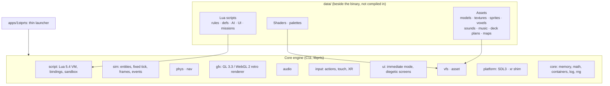
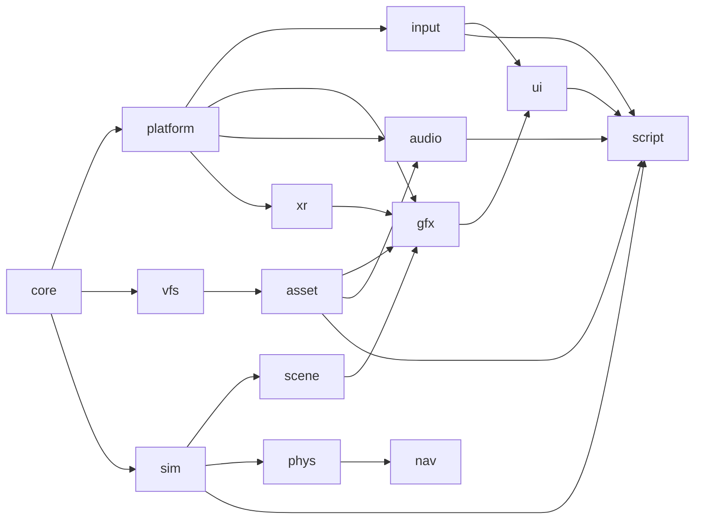

# Architecture Overview

This folder describes **how** 1stPRTS is built. The concept is in [`../concept/`](../concept/README.md).
Binding requirements are in [`../../openspec/`](../../openspec/).

| Document | Contents |
|---|---|
| This file | Layers, source tree, engine modules, the frame loop, the engine/script boundary |
| [simulation.md](simulation.md) | Fixed tick, entities, reference frames, levels of detail, determinism, saves, replays |
| [rendering.md](rendering.md) | OpenGL baseline, retro pipeline, depth layers, portals, sprites, voxels, stereo/XR |
| [data-and-scripting.md](data-and-scripting.md) | Folders next to the binary, virtual file system, mods, asset formats, the Lua API, sandbox |
| [quality-and-build.md](quality-and-build.md) | Tests, coverage gate, automated game tests, CI, build presets, dependencies |

## 1. Big picture



**Rule:** the engine knows *how* (rendering, physics, pathfinding, audio, file access, scripting).
The data folder knows *what* (every unit, rule, mission, interface, asset and shader). The
executable has **no game content compiled into it**. The one exception is a tiny built-in
error screen and font, used to report a missing or broken `data/` folder.

## 2. Source tree (planned)

```
CMakeLists.txt  CMakePresets.json
engine/
  include/prts/          public C headers (prts_*.h)
  src/
    core/                arenas, containers, math (float + double), hashing, rng, log, strings
    platform/            SDL3 window/context/events/time/paths/threads
    vfs/                 mount table, path rules, mod overlay, read and write areas
    asset/               registry, handles, async loading, hot reload, format loaders
    gfx/                 GL backend, shaders, meshes, sprites, voxels, passes, post, render targets
    scene/               reference-frame tree, cells and portals, culling, LOD selection
    sim/                 entity store, components, fixed-tick scheduler, events, state hash, save
    phys/                character controller, collision queries, platforms, triggers
    nav/                 terrain grid, interior graphs, pathfinding (from M2)
    audio/               mixer, 3D spatialization, buses, filters, streaming
    input/               devices → actions, contexts, touch overlay, XR controllers
    ui/                  immediate-mode UI, bitmap fonts, world-space screens
    script/              Lua VM, bindings (prts.*), sandbox, require via VFS, budgets, coverage hook
    xr/                  XR interface + WebXR backend (calls into web/ JS glue)
  tests/                 C unit tests, one suite per module
apps/1stprts/            main.c (SDL3 app callbacks), command line, crash reporting
web/                     Emscripten shell page, JS glue (WebXR, touch detection), Playwright tests
data/base/               the base game: scripts/, shaders/, assets, mod.lua, CREDITS.md
tests/game/              automated game tests: headless scenarios, replay checks, golden images
tools/                   coverage scripts, asset validator, credits checker, deck-plan tools (M3)
third_party/             vendored libraries, each with its LICENSE
```

The C symbol prefix is `prts_` (types `prts_*_t`, macros `PRTS_*`). C identifiers cannot start
with a digit, so `1stprts` is used only for the executable and product name.

## 3. Engine modules and dependencies



- Dependencies point one way only. `core` depends on nothing but the C standard library.
- **Only `platform/` and `xr/` include SDL3 or Emscripten headers.** Everything else goes through
  `prts_platform_*` and `prts_xr_*` interfaces. This keeps most of the engine testable without
  a window.
- **Only `gfx/` calls OpenGL.** It has a **null backend** for headless runs and tests.

## 4. The frame

The game uses SDL3's **app callback** entry points (`SDL_AppInit`, `SDL_AppIterate`,
`SDL_AppEvent`, `SDL_AppQuit`). These work the same on desktop and in the browser, with no
blocking main loop.

```
SDL_AppIterate  (or the WebXR frame callback while an XR session is active, see rendering.md)
 ├─ input:   gather device state → action states for this frame
 ├─ sim:     accumulate real time; run 0..N fixed ticks at 30 Hz
 │            ├─ script: dispatch queued events (budgeted)
 │            ├─ systems: commander controller, platforms, physics, frame tree update
 │            ├─ script: per-tick update (budgeted)
 │            └─ state hash (test builds), replay record
 ├─ look:    apply mouse/stick/head look every frame (no tick latency)
 ├─ render:  for each view (1 flat, or 2 XR eyes): interpolate transforms → passes → present
 └─ audio:   update listener and voices; mix a little ahead and queue it on the SDL audio stream
```

- The **simulation tick (30 Hz)** is fixed and independent of frame rate. Rendering
  **interpolates** between the last two ticks.
- **Looking around** is applied every frame from the newest input, so there is no added lag.
  Moving the body is simulated on the tick.

## 5. Threads

- The **main thread** runs the simulation, scripts and rendering.
- A **job system** on SDL3 threads decodes assets, builds meshes (voxels, deck plans), and later
  runs pathfinding batches. Jobs never touch simulation state directly. Their results are
  applied on the main thread at fixed points, so results stay deterministic.
- **Web:** the default web build has no threads (no `SharedArrayBuffer` requirement), and jobs
  run inline in small time slices. A threaded web build is optional for hosts that send the
  needed COOP/COEP headers.
- **Audio** mixing runs on SDL3's audio callback thread and gets commands through a lock-free
  queue.

## 6. The engine/script boundary

| Owned by C (engine) | Owned by Lua (data/base/scripts) |
|---|---|
| Everything that runs per frame or per entity in bulk: rendering, physics, collision, movement integration, pathfinding, sight and detection queries, projectile flight, audio mixing | Definitions (units, buildings, weapons, spells, factions, deck plans), match rules, economy, presence, succession |
| Asset loading and the file system | AI: captain behaviors and the opposing commander |
| The entity store and built-in components | Command interfaces: field map, war table, scrying pools, menus (via the UI API) |
| Determinism tools: tick, RNG streams, state hash | Missions, scenarios, campaign |
| Lua hosting: sandbox, budgets, hot reload, error containment | Input action definitions and default bindings |

Principles:
1. **Lua never holds C pointers.** Entities and assets are passed as **handles**
   (index + generation). A stale handle gives a clean Lua error, not a crash.
2. **Scripts are event-driven and spread over time.** There is no per-entity Lua call every tick
   for movement and similar work. Scripts react to events (`on_order`, `on_contact`,
   `on_damaged`…) and think at a throttled rate inside a time budget.
3. **The API is versioned** (`prts.api_version`). Breaking changes bump the major version, and
   mods state which version they target.
4. **Script failures are contained.** Errors are caught at the boundary, logged with a
   traceback, and shown in the developer console. The engine keeps running.

See [data-and-scripting.md](data-and-scripting.md) for the API layout.
